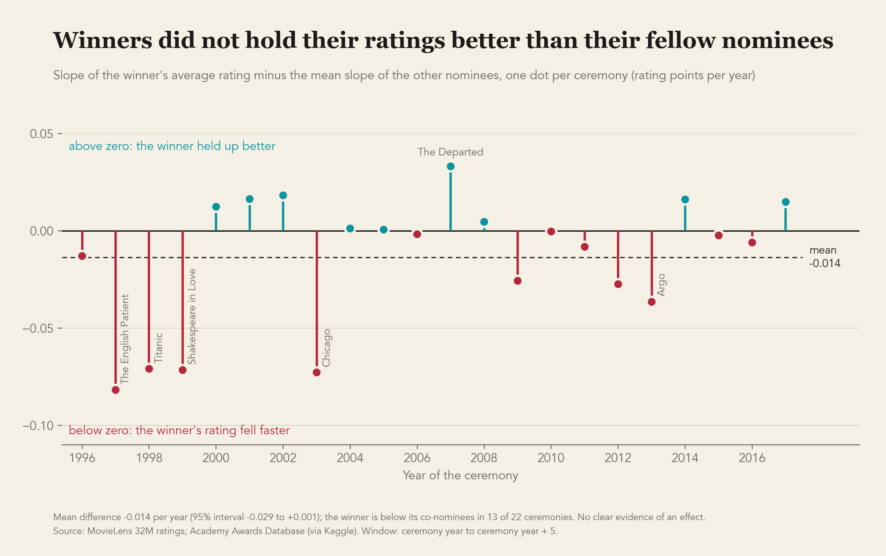
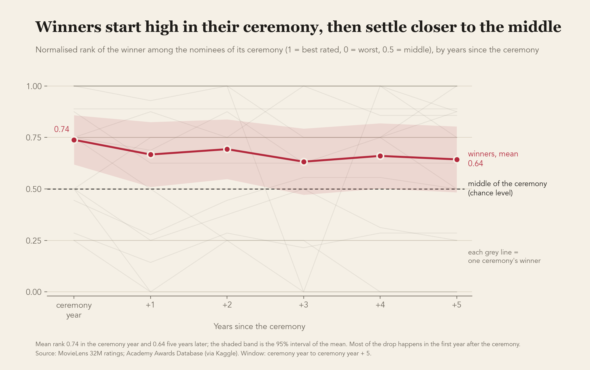

# Do Oscar-Winning Movies Age Better?

A data science study based on 32 million MovieLens ratings and the Best Picture records of the Academy Awards (ceremonies 1996 to 2017).

## Research questions

1. Do Best Picture winners maintain their audience ratings better over time than the other nominees of the same ceremony?
2. Does the position of the Best Picture winner among the nominees of its ceremony (ranked by average rating) improve, stay or get worse over the years after the ceremony?

## Main findings

Numbers come from `reports/results.md`, generated by `src/analysis.py`.

- **Question 1.** No clear evidence that winners keep their ratings better. Over the 6 years that start with the ceremony year, the rating of the winner falls slightly faster than the ratings of its fellow nominees (-0.014 rating point per year, 95% interval -0.029 to +0.001, p = 0.07), and the result is carried by a few ceremonies (1997, 1998, 1999, 2003). It is stable when the weights are removed or when little-rated years are dropped.
- **Question 2.** In the ceremony year the winner is clearly better ranked than its fellow nominees (normalised rank 0.74, where 0.5 is the middle). Five years later the advantage is smaller (0.64) and by 2022 it is no longer distinguishable from the middle (0.56). The loss of position is on the edge of chance after 5 years (p = 0.07) and clearer when the follow-up is extended to 2022 (p = 0.01, complementary analysis).
- These are associations in MovieLens ratings, not evidence about the effect of the Oscar itself.





## Study design

- **Population**: all Best Picture nominees of the ceremonies 1996 to 2017 (142 films, 22 winners). MovieLens starts in 1995 and its last complete year is 2022.
- **Link between the two sources**: each nominee is matched to its MovieLens `movieId` through its IMDb id (all 142 found), then checked against the titles and years.
- **Analysis window**: from the ceremony year to the ceremony year + 5 (6 calendar years), the same for every film. Every nominee was released the year before the ceremony, so the ceremony year is the first complete calendar year after release.
- **Measure**: average rating per film and per year of rating (UTC), with the number of ratings.
- **Question 1**: for each film, the slope of its yearly average rating (weighted by the number of ratings). For each ceremony, slope of the winner minus mean slope of the other nominees; then a t-test and a sign test on the 22 differences.
- **Question 2**: normalised rank of the winner among the nominees, (n - rank) / (n - 1), in the ceremony year and 5 years later (1 = best rated, 0 = worst, 0.5 = middle); then tests on the mean ranks and on the change.
- **Robustness of question 1**: no weights; only rows with at least 100 ratings.
- **Complementary analysis**: same questions with a follow-up from the ceremony year to 2022. Decided before looking at its results.
- **Comparison inside each ceremony**: the number of nominees changes from 5 to 10, and eras differ in MovieLens activity and audience.

Working assumption: a rating given in year *t* is treated as a viewing in year *t* (see Limitations).

## How to reproduce

Requires Python 3.9+.

```bash
python3 -m venv .venv
source .venv/bin/activate
pip install -r requirements.txt
```

Put the raw data in `data/raw/` (see Data), then run from the project root:

```bash
python src/build_nominees_table.py     # 142 nominees linked to MovieLens   -> data/processed/best_picture_nominees_1996_2017.csv
python src/build_film_year_table.py    # ratings per film and per year       -> data/processed/film_year_window.csv, film_year_until_2022.csv
python src/analysis.py                 # tests for questions 1 and 2         -> reports/results.md
python src/make_figures.py             # the two figures                     -> reports/figures/
```

Each script stops with an error message if one of its checks fails (142 nominees, 22 winners, 852 rows, same numbers as in the notebooks).

## Data

The data is not stored in this repository (see `.gitignore`). Create the folder `data/raw/` and place the datasets there:

- MovieLens 32M: download `ml-32m.zip` from https://grouplens.org/datasets/movielens/ and unzip it so that the files are in `data/raw/ml-32m/` (e.g. `data/raw/ml-32m/ratings.csv`). Ratings range from 1995-01-09 to 2023-10-13.
- Academy Awards nominees and winners: Kaggle dataset "The Oscar Award, 1927 - 2026" (`unanimad/the-oscar-award`, a scrape of the official Academy Awards Database), https://www.kaggle.com/datasets/unanimad/the-oscar-award. Downloaded on 2026-10-15 and unzipped into `data/raw/oscar_archive_1927_2025/` (files `the_oscar_award.csv` and `full_data.csv`). Best Picture nominees were compared with the official database (ceremonies 1996 to 2015) and with Wikipedia (2016 and 2017).

## Notebooks

The notebooks in `notebooks/` document the exploration and the reasoning behind the choices. The scripts above are the reproducible path.

| Notebook | What it does |
|---|---|
| `01_explore_movielens.ipynb` | first look at MovieLens (size, period, scale, titles) |
| `02_explore_oscars.ipynb` | first look at the Oscars file, how Best Picture is labelled |
| `03_match_oscars_movielens.ipynb` | links the 142 nominees to MovieLens by IMDb id and checks the match |
| `04_yearly_ratings.ipynb` | yearly ratings per film, weighted slopes, tests for questions 1 and 2, robustness |

## Project structure

```
data/raw/        original downloaded data, never modified
data/processed/  tables produced by the scripts
notebooks/       exploration and reasoning
src/             scripts that rebuild every table, result and figure
reports/         results.md and figures/
```

## Limitations

- MovieLens users are not representative of all moviegoers.
- A rating timestamp records when a rating was submitted, not necessarily when the film was watched. Some users rate many films at the same second (bulk rating), which suggests ratings of films seen long before.
- The audience that rates a film changes over time, so a change in the average rating does not necessarily mean that the film changed.
- Only 22 winners are available, so the study has limited statistical power, and the main results are on the edge of statistical significance.
- A very popular film may be rated by a different audience than a little-known one. This is a bias, not noise, and weighting by the number of ratings does not remove it. Each winner is compared with the nominees of the same ceremony, but this limitation remains.
- The slope is a straight-line summary of six yearly averages, and the rank is compared at only two dates. Several tests were run (main analysis, two robustness checks, complementary analysis), so isolated small p-values should be read with caution.
- Yearly averages are rounded to two decimals in the processed tables, which creates ties in the ranks.
